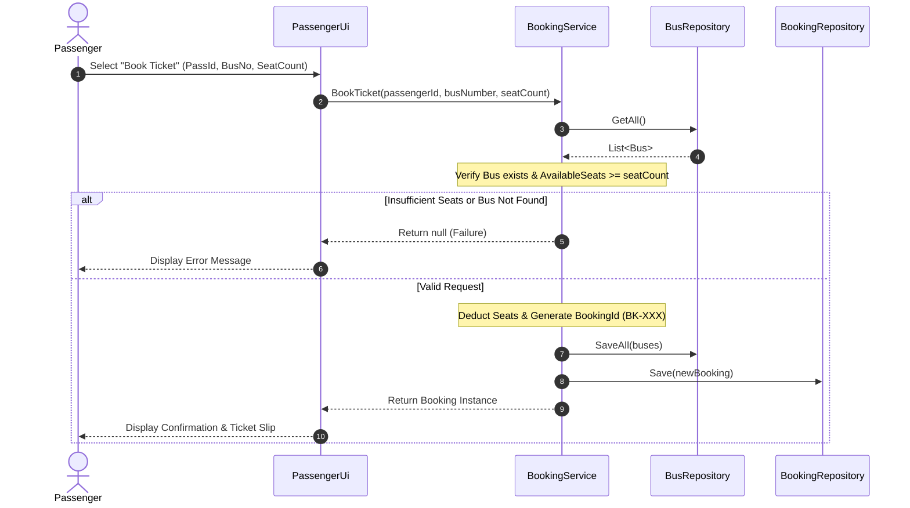

# 🚌 Bus Management & Reservation System

[](https://dotnet.microsoft.com/)
[](https://learn.microsoft.com/dotnet/csharp/)
[](#system-architecture)
[-lightgrey?style=for-the-badge)](#data-layer-specification)
[](#author)

> A modular, menu-driven bus fleet and ticketing reservation platform written in **C# (.NET 10)**. Built following strict **Object-Oriented Programming (OOP)** principles and an **N-Tier Layered Architecture** separating the User Interface (UI), Business Logic (BL), and Data Layer (DL).

---

## 📋 Table of Contents
- [Key Features](#-key-features)
- [System Architecture](#-system-architecture)
- [Project Directory Structure](#-project-directory-structure)
- [Application Flow & Sequence](#-application-flow--sequence)
- [Console UI Preview](#-console-ui-preview)
- [Data Layer Specification](#-data-layer-specification)
- [Getting Started](#-getting-started)
- [Data Path Configuration & Portability](#-data-path-configuration--portability)
- [Step-by-Step Verification & Demo Guide](#-step-by-step-verification--demo-guide)
- [Design Principles & OOP Concepts](#-design-principles--oop-concepts)
- [Future Roadmap & Extensibility](#-future-roadmap--extensibility)
- [Author](#author)

---

## ✨ Key Features

### 🛠️ Administrator Portal
- **Secure Authentication**: Password-protected console access (default password: `admin`).
- **Bus Fleet Management**:
  - Register new buses with total seating capacities.
  - Dynamically assign or detach routes.
  - Update bus seat capacities and route assignments.
  - Delete decommissioned buses.
- **Route Network Management**:
  - Add origin, destination, and fare configurations.
  - Edit transit details or remove inactive routes.
- **Booking Auditing & Oversight**:
  - View master booking registers across all passengers and buses.
  - Search any reservation instantly using its unique `BK-XXX` identifier.

### 🎫 Passenger Portal
- **Route & Bus Exploration**:
  - Browse active routes and associated bus schedules.
  - Search routes by Route ID, Origin city, or Destination city.
- **Smart Ticket Booking**:
  - Automatic passenger profile registration upon first booking.
  - Multi-seat reservation with instant seat availability validation.
  - Dynamic fare calculation (`Total = Tickets × FarePerTicket`).
  - Automated generation of unique booking reference IDs.
- **Booking Management & Cancellation**:
  - Real-time booking inquiry by Passenger ID or Booking ID.
  - One-click booking cancellation with **automatic seat restoration** back to the bus fleet.
  - Clean state handling: Cancelled records are displayed once and archived.

---

## 🏛️ System Architecture

The application implements a decoupled **3-Tier / Layered Architecture** to enforce **Separation of Concerns (SoC)** and maintainability:

```
┌─────────────────────────────────────────────────────────────┐
│                   Presentation Layer (UI)                   │
│   MainMenu.cs  │  AdminUi.cs  │  PassengerUi.cs  │ Util     │
└──────────────────────────────┬──────────────────────────────┘
                               │ Method Calls (Input/Display)
                               ▼
┌─────────────────────────────────────────────────────────────┐
│                 Business Logic Layer (BLL)                  │
│  AdminService │ BookingService │ BusService │ RouteService │
└──────────────────────────────┬──────────────────────────────┘
                               │ DTO / Domain Models
                               ▼
┌─────────────────────────────────────────────────────────────┐
│                  Data Access Layer (DAL)                    │
│ BookingRepo   │ BusRepo       │ PassengerRepo│ RouteRepo   │
└──────────────────────────────┬──────────────────────────────┘
                               │ File I/O (StreamReader / StreamWriter)
                               ▼
┌─────────────────────────────────────────────────────────────┐
│               Persistent Storage (DATA/*.txt)               │
│ bookings.txt   │ buses.txt    │ passengers.txt│ routes.txt  │
└─────────────────────────────────────────────────────────────┘
```

| Layer | Namespace / Directory | Responsibility |
| :--- | :--- | :--- |
| **Presentation (UI)** | `Project_02_nov.UI` | Handles console menus, user input capture, validations, screen rendering, and ANSI formatting. Contains zero database or business logic. |
| **Business Logic (BL)** | `Project_02_nov.Service` | Enforces domain rules (e.g., preventing overbooking, computing fares, generating IDs, credential checks). |
| **Data Layer (DL)** | `Project_02_nov.Repository` | Manages file I/O operations (`StreamReader`, `StreamWriter`), parsing CSV records into memory models and persisting changes. |
| **Domain Models** | `Project_02_nov.Models` | Pure data entities (`Bus`, `Route`, `Passenger`, `Booking`) with serialization logic (`ToString()`). |

---

## 📂 Project Directory Structure

```text
Project_02_nov/
├── DATA/                                # Persistent flat-file storage
│   ├── bookings.txt                     # Booking transactional logs
│   ├── buses.txt                        # Bus fleet records and route bindings
│   ├── passengers.txt                   # Registered passenger database
│   └── routes.txt                       # Transit routes and pricing table
├── Models/                              # Core OOP domain entities
│   ├── Booking.cs                       # Booking model & serialization
│   ├── Bus.cs                           # Bus model & seat tracking
│   ├── Passenger.cs                     # Passenger details model
│   └── Route.cs                         # Route definitions & fare model
├── Repository/                          # Data Access Layer (DAL)
│   ├── BookingRepository.cs             # File reader/writer for bookings
│   ├── BusRepository.cs                 # File reader/writer for buses
│   ├── PassengerRepository.cs           # File reader/writer for passengers
│   └── RouteRepository.cs               # File reader/writer for routes
├── Service/                             # Business Logic Layer (BLL)
│   ├── AdminService.cs                  # Admin credential and session rules
│   ├── BookingService.cs                # Reservation, seat verification & cancellation
│   ├── BusService.cs                    # Bus validation and fleet queries
│   ├── PassengerService.cs              # Passenger existence and registration rules
│   └── RouteService.cs                  # Route verification and search routines
├── UI/                                  # Presentation Layer (Console UI)
│   ├── AdminUi.cs                       # Admin management menus and prompts
│   ├── ConsoleUtility.cs                # Console helpers (Clear, Pause, Error styling)
│   ├── MainMenu.cs                      # Top-level portal switch
│   └── PassengerUi.cs                  # Passenger booking and lookup views
├── Program.cs                           # Application entry point
├── Project_02_nov.csproj                # Project definition & .NET 10 target
└── Project_02_nov.slnx                  # Solution configuration file
```

---

## 🔄 Application Flow & Sequence



---

## 🖥️ Console UI Preview

```text
========================================
       BUS MANAGEMENT SYSTEM (v2.0)     
========================================
1. Administrator Portal
2. Passenger Portal
3. Exit Application
----------------------------------------
Select an option (1-3): 2

======= PASSENGER MENU =======
1. View Available Routes
2. Search Routes (by City/ID)
3. Book Ticket
4. Cancel Booking
5. View My Booking
6. Return to Main Menu
Choose your option: 3

Enter Passenger ID: P-102
Enter Bus Number: BUS-01
Enter Number of Seats: 2

>>> SUCCESS: Booking Confirmed!
----------------------------------------
Booking ID      : BK-105
Passenger ID    : P-102
Bus Number      : BUS-01
Seats Booked    : 2
Fare Per Ticket : $25.00
Total Amount    : $50.00
Status          : Confirmed
----------------------------------------
```

---

## 💾 Data Layer Specification

All data records are stored in comma-separated value format (`.txt`) under the `DATA/` directory:

### 1. `buses.txt`
| Field Index | Field Name | Data Type | Description | Example |
| :---: | :--- | :--- | :--- | :--- |
| 0 | `BusNumber` | `string` | Unique bus identification key | `BUS-101` |
| 1 | `TotalSeats` | `int` | Total capacity of the vehicle | `40` |
| 2 | `AvailableSeats` | `int` | Real-time unreserved seat count | `36` |
| 3 | `RouteId` | `string` | Assigned Route ID (or blank if unassigned) | `R-01` |

### 2. `routes.txt`
| Field Index | Field Name | Data Type | Description | Example |
| :---: | :--- | :--- | :--- | :--- |
| 0 | `RouteId` | `string` | Unique route identification key | `R-01` |
| 1 | `Source` | `string` | Origin departure terminal/city | `Lahore` |
| 2 | `Destination` | `string` | Arrival terminal/city | `Islamabad` |
| 3 | `Fare` | `double` | Base price per individual seat ticket | `1800.0` |

### 3. `passengers.txt`
| Field Index | Field Name | Data Type | Description | Example |
| :---: | :--- | :--- | :--- | :--- |
| 0 | `PassengerId` | `string` | Unique passenger identification key | `P-501` |
| 1 | `Name` | `string` | Full name of the passenger | `John Doe` |
| 2 | `Age` | `int` | Age of passenger | `28` |

### 4. `bookings.txt`
| Field Index | Field Name | Data Type | Description | Example |
| :---: | :--- | :--- | :--- | :--- |
| 0 | `BookingId` | `string` | Unique auto-generated booking code | `BK-101` |
| 1 | `PassengerId` | `string` | Reference to passenger | `P-501` |
| 2 | `BusNumber` | `string` | Reference to assigned bus | `BUS-101` |
| 3 | `FareAtBooking` | `double` | Locked-in fare per ticket at time of booking | `1800.0` |
| 4 | `Status` | `string` | Reservation state (`Confirmed`, `Cancelled`) | `Confirmed` |
| 5 | `TicketsBooked` | `int` | Quantity of seats reserved | `2` |

---

## 🚀 Getting Started

### Prerequisites
- Operating System: Windows, Linux, or macOS.
- SDK: [.NET 10.0 SDK](https://dotnet.microsoft.com/download/dotnet/10.0) or higher.

### Installation & Execution
1. **Clone or Navigate to the Project**:
   ```bash
   cd "d:\2nd semester\sir laeeq ,OOPS\WEEK 5\Project_02_nov"
   ```

2. **Restore and Build**:
   ```powershell
   dotnet build
   ```

3. **Run the Application**:
   ```powershell
   dotnet run --project .\Project_02_nov.csproj
   ```

### Default Credentials
- **Role**: Administrator
- **Password**: `admin` *(configured in `Service/AdminService.cs`)*

---

## ⚙️ Data Path Configuration & Portability

> [!IMPORTANT]
> The repository classes currently reference the project's absolute directory path:
> ```csharp
> private readonly string _filePath = "D:\\2nd semester\\sir laeeq ,OOPS\\WEEK 5\\Project_02_nov\\DATA\\buses.txt";
> ```

### Making the Paths Portable (Recommended Refactor)
To enable the application to run smoothly on any workstation without updating file paths manually, initialize the paths dynamically relative to the application directory:

```csharp
// Example in Repository constructors:
private readonly string _filePath;

public BusRepository()
{
    string baseDir = AppDomain.CurrentDomain.BaseDirectory;
    string projectRoot = Path.GetFullPath(Path.Combine(baseDir, @"..\..\.."));
    _filePath = Path.Combine(projectRoot, "DATA", "buses.txt");
}
```

---

## 🧪 Step-by-Step Verification & Demo Guide

Follow this test scenario to verify all tiers of the application:

1. **Launch System**: Run `dotnet run`.
2. **Admin Setup**:
   - Select option `1` (Admin Menu) and enter password `admin`.
   - Add a Route: `R-100`, Source: `Lahore`, Destination: `Multan`, Fare: `1500`.
   - Add a Bus: `BUS-99`, Total Seats: `30`, Route ID: `R-100`.
   - Exit back to Main Menu.
3. **Passenger Reservation**:
   - Select option `2` (Passenger Menu).
   - Choose `1` (View Routes) to verify `R-100` is listed with `BUS-99`.
   - Choose `3` (Book Ticket):
     - Passenger ID: `P-01` (Provide Name and Age when prompted).
     - Bus Number: `BUS-99`.
     - Number of Seats: `3`.
   - Record the issued `Booking ID` (e.g. `BK-101`).
4. **Audit Seat Inventory**:
   - Return to Admin Menu -> View Buses.
   - Verify `BUS-99` available seats dropped from `30` to `27`.
5. **Cancellation & Inventory Restoration**:
   - Return to Passenger Menu -> Choose `4` (Cancel Booking).
   - Input `BK-101`.
   - Verify cancellation message.
   - Check bus seats: Available seats return to `30`.

---

## 🧠 Design Principles & OOP Concepts

- **Encapsulation**: Models bundle properties with validation rules and provide standard serialization (`ToString()`).
- **Separation of Concerns (SoC)**: UI never performs direct file I/O; Repositories never render output or handle user prompts; Services encapsulate business and domain validation logic.
- **Fail-Safe Defensive Programming**: Null safety checks, numeric bounds checking on seating capacities, and file existence validations guard against runtime crashes.
- **State Integrity**: Cancellation routines atomically reverse seat allocations, keeping persistent data records in sync with runtime state.

---

## 🔮 Future Roadmap & Extensibility

- [ ] **Interface Abstraction**: Introduce `IRepository<T>` and `IService<T>` for dependency inversion.
- [ ] **Dependency Injection**: Utilize `Microsoft.Extensions.DependencyInjection` for IoC container management.
- [ ] **Relational Database Migration**: Transition from flat CSV text storage to SQLite / Entity Framework Core.
- [ ] **Individual Seat Mapping**: Implement visual 2D matrix seat layouts (e.g., `1A`, `1B`, `2A`, `2B`).
- [ ] **Automated Testing Suite**: Implement xUnit/NUnit test coverage for `BookingService` and `BusService`.

---

## Author

**M.ARMAN**  
GitHub: [@armanbuilds](https://github.com/armanbuilds)  
Academic Course: Object-Oriented Programming (OOP) - 2nd Semester  
Supervisor: Sir Laeeq  
